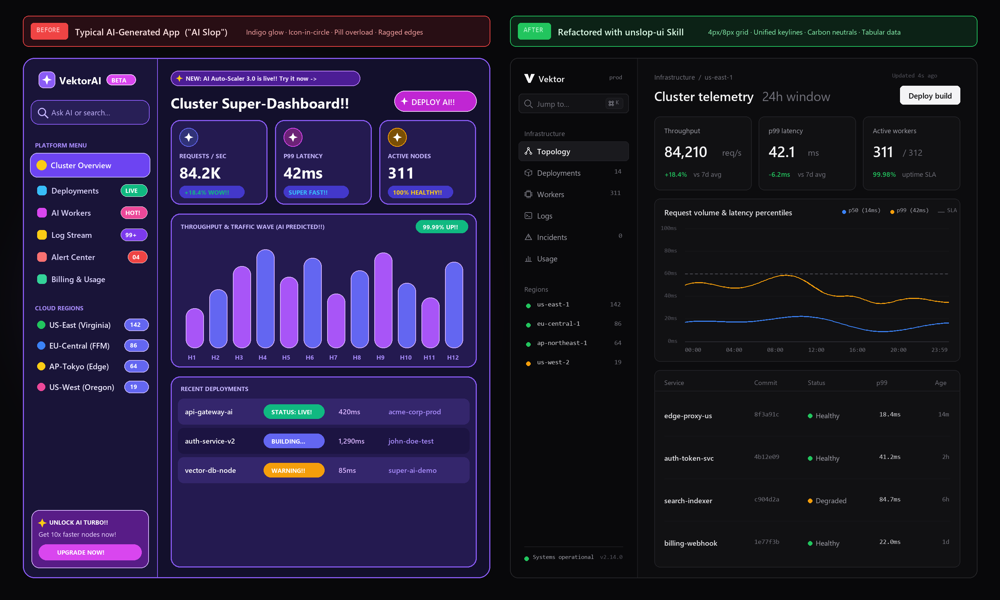

# unslop-ui

**A comprehensive design-engineering `SKILL.md` for AI coding agents to diagnose and eliminate "AI slop" in user interfaces.**



AI-generated frontends suffer from a recognizable cluster of visual and structural habits: neon purple/indigo gradients, arbitrary off-grid spacing (`22px`, `30px`, `42px`), misaligned vertical keylines, emoji clutter (`🔥 +12%!!`), `ALL CAPS` label overuse, saturated pill-badge overload, and low-signal "toy" charts without axes.

`unslop-ui` gives your coding agent (Antigravity, Claude Code, Cursor, Windsurf, Codex, etc.) a deterministic **4-Stage Execution Loop** and **12 Design-Engineering Protocols**—complete with **Vanilla CSS variables** and **Tailwind CSS** before/after patterns—to transform generic AI output into calm, craft-grade interfaces.

---

## What Changed? (The Anatomy of an Unslop)

| Dimension | ❌ AI Slop (Before) | ✅ Craft-Grade UI (After) |
| :--- | :--- | :--- |
| **Vertical Rhythm** | Arbitrary gaps (`22px`, `34px`, `46px`), bloated `p-8` padding everywhere | Strict **`4px`/`8px` spatial grid** (`4, 8, 12, 16, 24, 32px`), compact `28px–36px` nav/input rows |
| **Horizontal Keylines** | Ragged left edges (logo at `44px`, search at `22px`, section headers at `34px`) | Single **unified vertical keyline rail** shared by logo, inputs, section labels, and nav icons |
| **Surface Palette** | Blue/purple-tinted dark mode (`#13102C`), neon radial blobs, heavy `backdrop-blur` | **True carbon/obsidian neutrals** (`#09090B`, `#111113`, `#18181B`) or crisp alabaster (`#FAFAFA`, `#FFFFFF`) |
| **Borders & Depth** | Glowing colored borders (`border-purple-500/40`), heavy colored drop shadows | Crisp **`1px solid` hairline borders** (`rgba(255,255,255,0.07)` dark / `#E4E4E7` light) |
| **KPI Cards & Icons** | Icons trapped inside 20%-opacity colored circles, `ALL CAPS` headers, `rounded-full` pill deltas | Pure typographic hierarchy, `Sentence case` labels, inline units (`req/s`, `ms`), `tabular-nums` |
| **Copy & Chrome** | `VektorAI [BETA]`, `NEW: AI Auto-Scaler 3.0 is live!!`, `DEPLOY AI!!`, `UNLOCK AI TURBO!!` | Clean brand (`Vektor`), contextual header (`Cluster telemetry 24h window`), restrained `Deploy build` CTA |
| **Data Visualization** | Thick rounded purple capsule bars (`H1–H12`) with no Y-axis, no gridlines, fake heights | Explicit Y-axis scale (`0ms–100ms`), `1px` hairline gridlines, dashed SLA threshold, `1.5px` p50/p99 curves |
| **Data Tables** | Heavy zebra striping, giant glowing status pills (`STATUS: LIVE!`), unaligned numbers, `john-doe-test` | `1px` row dividers, `6px` semantic status dots (`Healthy`, `Degraded`), right-aligned tabular `p99` & `Age` |

---

## The 12 Unslop Protocols Included in [`SKILL.md`](./SKILL.md)

1. **Strict `4px`/`8px` Spatial Grid & Density Calibration** — Eliminates arbitrary pixel gaps and calibrates row/input heights to `32px–36px`.
2. **Unified Keylines & Optical Alignment** — Enforces continuous left and right vertical alignment rails across sidebars, headers, and bento grids.
3. **De-Purpling, Glow Removal & True Neutral Surfaces** — Strips unsolicited indigo/violet gradients in favor of luminance-stepped carbon/alabaster surfaces and `1px` hairlines.
4. **Typography, Casing & Numeric Discipline** — Enforces `Sentence case` labels, `tabular-nums` on all figures, tight display tracking (`-0.025em`), and two-tone contextual headings.
5. **Emoji Purge, Copywriting Detox & Authentic Data** — Bans decorative emojis, exclamation marks (`!`, `!!`), fake `AI`/`PRO` badges, and `Lorem ipsum` / `John Doe` placeholders.
6. **Badges, Pills & Status Indicator Restraint** — Replaces glowing pill counters with quiet right-aligned tabular numbers and `6px` semantic dots.
7. **Iconography Discipline** — Eliminates the "colored icon inside a 20%-opacity rounded square" trope and enforces a single `1.5px`-stroke monochrome icon set.
8. **Data Visualization & Chart Craft** — Requires quantitative Y-axis scales, hairline gridlines, and thin `1.5px` strokes instead of thick rounded purple bars.
9. **Decorative Assets & Skeuomorphic Restraint** — Replaces cartoon clipart SVGs with typographic restraint or monochrome depth-lit renders.
10. **Landing Pages & Marketing Sites** — Kills gradient text headlines, glowing announcement pills, 3-column icon-in-box grids, and scaled-up middle pricing cards.
11. **Tables, Forms, Modals & Empty States** — Enforces right-aligned numeric table columns, consistent `36px` form controls, two-column settings layouts, and sober empty states.
12. **Micro-Interactions & Motion Restraint** — Bans `hover:scale-105` card jumps in favor of crisp `120ms–150ms ease-out` color and border transitions.

---

## Installation

### Google Antigravity

**Global installation (available across all workspaces):**
```bash
mkdir -p ~/.gemini/config/skills/unslop-ui
curl -fsSL https://raw.githubusercontent.com/SmileFlow-Steve/unslop-ai-ui/main/SKILL.md \
  -o ~/.gemini/config/skills/unslop-ui/SKILL.md
```

**Workspace-specific installation:**
```bash
mkdir -p .agents/skills/unslop-ui
curl -fsSL https://raw.githubusercontent.com/SmileFlow-Steve/unslop-ai-ui/main/SKILL.md \
  -o .agents/skills/unslop-ui/SKILL.md
```

### Claude Code / Cursor / Windsurf / Other Agents

Copy [`SKILL.md`](./SKILL.md) into your agent's skill or rules directory:
- **Claude Code**: `.claude/skills/unslop-ui/SKILL.md`
- **Cursor**: `.cursor/rules/unslop-ui.mdc` (or reference `SKILL.md` in `.cursorrules`)
- **Universal**: Drop `SKILL.md` into `.agents/skills/unslop-ui/SKILL.md` or paste its contents into your project's `AGENTS.md` / `GEMINI.md` / `CLAUDE.md`.

---

## Usage

Once installed, trigger the skill in your prompt whenever you are building or refactoring a frontend:

- *"Unslop this dashboard and align it to a strict grid."*
- *"Review this landing page with the `unslop-ui` skill and fix every violation."*
- *"Build a billing overview page—make sure it's completely unslopped."*

The agent will automatically run the **4-Stage Execution Loop**:
1. **Audit & Diagnose** the existing UI against the Quick-Scan Diagnostic Matrix.
2. **Lock Design Tokens** (CSS custom properties or Tailwind equivalents).
3. **Refactor Components** across all 12 protocols.
4. **Verify** against the 7-point pre-completion checklist.

---

## License

MIT

